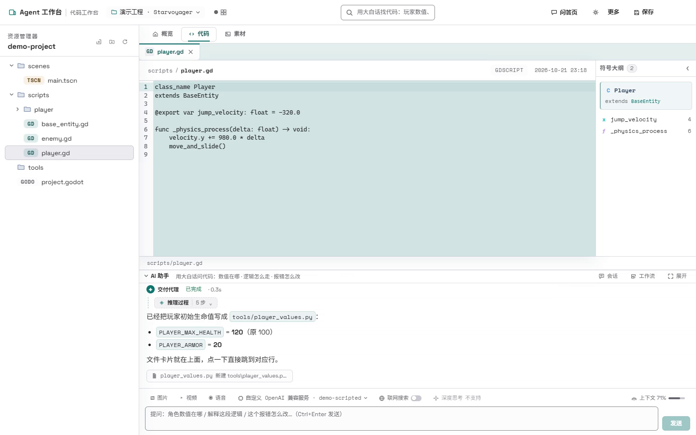
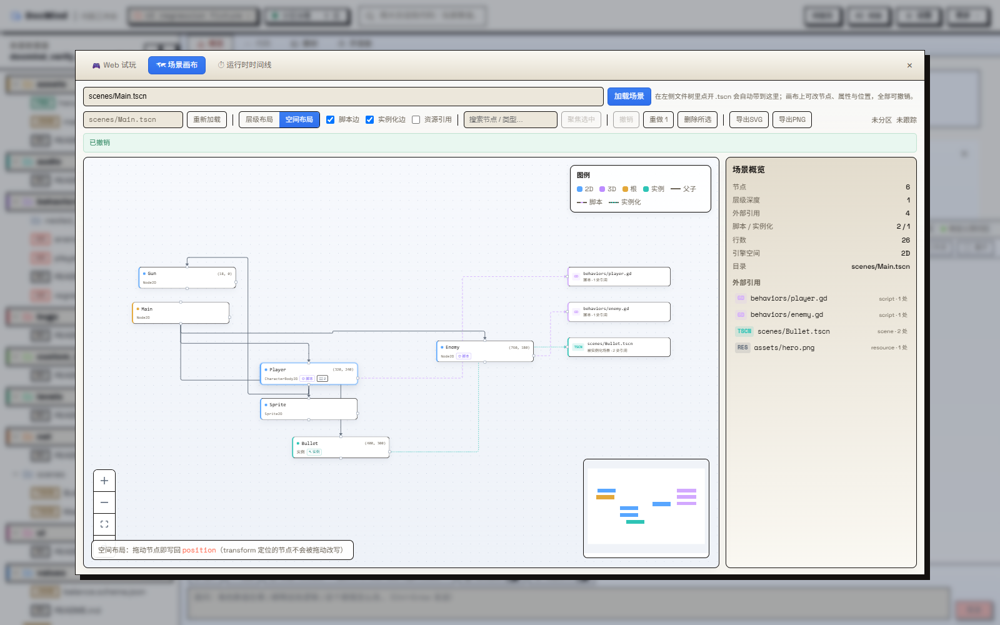
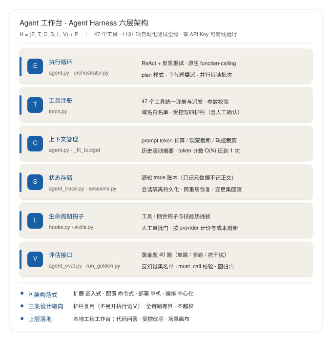

# Agent Workbench

> **An Agent Runtime (Harness) for engineering codebases** — it turns "an agent that runs" into an **observable, orchestrable, regressable** system.

[](https://github.com/j77156057-art/agent-workbench/actions/workflows/harness.yml)


[](https://opensource.org/licenses/MIT)

**▶ Run it without installing anything: [Releases · DocMind-20261030-994a318-win64.zip](https://github.com/j77156057-art/agent-workbench/releases)** — unzip, double-click `DocMind.exe`. No Python, no API key, no network; the default local mock model runs the whole flow.

**▶ 60-second demo** — five steps on a real Godot project: ask → the model writes a values file and hands you a clickable artifact card → the relation graph unfolds class inheritance and scene mounts → edit a node property in the scene canvas and write it back to the `.tscn` → undo it in one click.

<div align="center">
  
</div>

<sub>Every step in the demo is a real operation: the written file lands in the project, the relation graph comes from real inheritance and mount parsing, the property is really written back to the `.tscn`, and undo really restores it.
[Watch the MP4 (1440×900, 62s)](https://raw.githubusercontent.com/j77156057-art/agent-workbench/main/docs/screenshots/demo.mp4) · [file in the repo](docs/screenshots/demo.mp4)</sub>

<div align="center">
  
  
</div>

<sub>Left: the trace ledger — per-turn tokens / latency / tool sequence / outcome, **metadata only; prompt and answer text are never written to disk**.
Right: the scene canvas — a visual, editable node graph of a Godot `.tscn`; every edit is undoable and undo restores the file byte-for-byte.</sub>

---

## What it is

Agent Workbench has two identities that only make sense together:

| | |
|---|---|
| **Harness (the core)** | An agent runtime that runs fully offline. A systematic tool registry, HTTP endpoints and a full backend test suite, plus a per-turn trace ledger, capability leases, a human approval ledger, region governance, DAG multi-agent orchestration, golden-set regression gates — **observable, orchestrable, regressable**. |
| **Workbench (the landing)** | A local workbench for game / Mod projects: code Q&A, controlled rewriting, scene canvas, runtime timeline, engine embedding, GPU coordination, EDA acceptance. |

The workbench is not a skin over the core — it is the Harness's **real landing environment**: a complex, side-effect-heavy engineering project that can actually break. Without such an environment, guardrails are just paperwork.

**Runs with zero API key**: the default provider is a local `mock`. Install the dependencies and you can ask questions, edit code and run acceptance checks. Switch to a cloud model whenever you like — the change takes effect in the UI, no restart.

## Why it exists

When an agent meets a real codebase, it falls into the same two traps:

**Hallucination.** The AI confidently says "damage is calculated in `player.py`" — and that file does not exist. The engineering answer is not "please be more careful in the prompt" but **making every claim carry checkable evidence**: file line numbers, code-block hashes, retrieval hit counts, raw tool output.

**Loss of control.** After an edit you don't know what changed, how many tokens it burned, or whether it will happen again. The answer is to split the agent into six layers, each with a guardrail that **can be tested** — rather than a prayer written into the system prompt.

<div align="center">
  
</div>

| Layer | Responsibility | Key implementation |
|---|---|---|
| **E Execution loop** | ReAct + reflection retry, native function-calling, plan mode, sub-agent delegation, parallel read-only batches, DAG multi-agent orchestration with failure re-planning | `agent.py` · `orchestrator.py` |
| **T Tool registry** | A declarative tool registry; argument validation, domain allowlist, **controlled writes** (read-before-write + size cap + syntax check + human approval) | `tools.py` · `agent_runtime/tool_domains.py` |
| **C Context management** | prompt token budget, observation truncation, trail pruning (system prompt and current question never dropped), rolling history summary | `agent.py::_fit_budget` |
| **S State storage** | per-turn trace ledger (**metadata only, never prompt/answer text**), session isolation & persistence, survives restart | `agent_trace.py` · `sessions.py` |
| **L Lifecycle hooks** | hot-pluggable hooks / skills, human approval gate, per-provider pricing with cost circuit breaker | `hooks.py` · `skills.py` · `pricing.py` |
| **V Evaluation** | golden-set rule scoring + optional LLM-judge + **baseline regression gate** (exit code 1 on regression) | `agent_eval.py` · `run_golden.py` · `golden/` |

Three design commitments run through all of it:

1. **Reuse the guardrails** — native function-calling and parallel batches go through the existing guardrails instead of opening new execution paths. One set of semantics, not two.
2. **Bounded** — trails, observations, history and batches are all truncated or summarized; context and prompts never explode.
3. **No overreach** — the orchestrator only rewrites *not-yet-executed* tasks, writes are never concurrent, hook exceptions are always swallowed.

## The workbench

One Web UI; the desktop app is just that UI in a native window. Twenty-one panels, grouped by what you are trying to do:

| Group | Panels | What it answers |
|---|---|---|
| **Understand the code** | AI assistant · Symbol map · Relation graph · Unity graph · Flow graph · Change overview · Region map | Symbol-level search, inheritance and reference relations, the decision chain of every turn, uncommitted changes, region dependency DAG |
| **Change & accept** | Selection AI · Scene canvas · Runtime timeline · EDA multimodal acceptance · Live conversation | Explain / rewrite a selection; visualize and edit `.tscn`; the gameplay event timeline; three-state acceptance of Vivado / KLayout reports; camera and voice straight into a local realtime model |
| **Engineering facilities** | Tasks & generation · GPU monitor · Run & engine · AI console · Asset center | Task branches and ComfyUI generation, VRAM leases and queuing, engine launch and embedding, per-turn trails and breakpoints, asset library and generation |
| **Foundations** | Overview cockpit · File tree / editor · Unified settings · Model settings | Project overview and onboarding, multi-tab CodeMirror, one place for model / MCP / Agent policy / voice config |

A few worth calling out:

- The **relation graph** uses a **left-to-right layered inheritance tree**, not force-directed. On a real project it measured 1485 nodes and 1245 inheritance edges — force-directed turns that scale into a hairball. The layered tree makes inheritance readable at a glance; the cost is that wide fan-outs fold into an "N subclasses" card (click to expand), and search narrows to the relevant subtree.
- **Artifact cards**: files the model wrote and screenshots it took are rendered **directly under the answer** — images as thumbnails, files as clickable names. No more hunting through paths for "what did it actually produce".
- The **scene canvas** draws Godot `.tscn` as a node graph, parent edges and instance edges in separate colors, properties and positions editable, **everything undoable and undo restores the file byte-for-byte**.
- **Live conversation** streams camera / screen-share frames and voice into a local realtime multimodal model over WebSocket.
- The **task panel** carries four actions: scope validation, snapshot, snapshot rollback and impact analysis — you first pin down which paths the task is allowed to touch, and a violation is rejected on the spot; rollback restores files to their snapshot content (files created after the snapshot are removed); a task branch opens a git branch named `docmind/<task>` and refuses to switch while the worktree has uncommitted changes.
- **Context memory**: the "Memory" button beside the composer opens a right-hand drawer with the content actually injected next turn — L0 constitution / L1 profile / L2 shared memory / L3 task book / L4 session hooks / history summary. Constitution, profile, task book and hooks are editable; candidates can be adopted or promoted; relation edges can be added/removed; the index can be rebuilt.
- **Voice models**: the endpoint, model and voice of STT / TTS / realtime Omni are edited and persisted from the settings page — **no `.env` edit and no restart**.
- **Plan runs**: the "Plan" chip beside the composer opens the Plan panel — give it a goal and a review interval and the model keeps executing the task book in the background, **and does not stop until every item is crossed off**; once closed out it switches to periodic review (reviewed every change? actually ran the tests? anything obviously missing? what could still improve?). Each turn's actions and the trade-offs the model logs itself land in the decision ledger for later review. **Only the user can stop it**: closing the panel does not, the model has no stop tool, and ordinary chat requests return 409 while a Plan runs.

## Capabilities

### The tool surface: declarative, grouped by domain

Classification is **declarative** (`agent_runtime/tool_domains.py`), never inferred from names — a new tool that doesn't declare a domain fails the gate. The full list is available at runtime via the `tool_catalog` tool.

| Domain | Covers |
|---|---|
| `files` | Read/write inside the project, content / symbol / glob search, reference location, atomic multi-file rewrite, read/write/delete outside the allowlist |
| `verify` | Run tests, CI conclusions, contract validation, dependency reconciliation, index rebuild, changeset rollback, approval status |
| `frontend` | Start a dev server, click / type / read in a real browser, capture and drive the desktop, **visual locate + visual click**, Vue component-level and app-level acceptance |
| `preview_adapter` | Design a declarative preview adapter for a new file type or runtime: draft → approve → controlled refresh → rollback → fixture test |
| `mcp` | Connector config and probing, calls, official Registry search, **candidate discovery from a natural-language need**, capability approval, isolated install and audit |
| `plan` | Plans, region proposals and application, region read/write/verify, workflow start, lanes, handoff, pricing, refactoring; session timers (`timer_set` / `timer_list` / `timer_cancel`) and Plan decision logging (`plan_decision`) |
| `task` | Defect registration and updates, skill creation and approval, asset registration and catalog |
| `git` | diff, log, per-region commit, commit-all with a recorded changeset |
| `data` | Data file inspection and generation, DOCX / PDF / PPTX / XLSX artifacts, numeric evaluation, video prompts |
| `jobs` | Run commands, run Python (sandboxed subprocess), inspect and cancel background jobs |
| `web` | Search, fetch page text, bulk research, subtitles, translation, weather, **built-in browser** (public web only) |
| `knowledge` | Search uploaded material, memory read/write, recall experience |
| `game` | Launch / stop / hot-reload the engine, engine screenshot, numeric simulation, impact analysis, pre-release check, task registration |
| `eda` | Really run Vivado / KLayout / simulation and parse the output, turn online reports into structured facts, produce a three-state acceptance verdict |
| `net` | HTTP requests constrained by an allowlist (SSRF defense) |
| `catalog` | Look up tool inventory and usage by domain |

### Long-term memory: layered, retrievable, auditable

Enable **Layered memory v2** in Settings; when off, the old verbatim memory path and prompts are unchanged. Memory is **file-first, with SQLite as a rebuildable index** — a broken index cannot lose facts, and legacy stores migrate per project instead of leaking into a global bucket.

| Layer | What it holds | Mechanism |
|---|---|---|
| **L0 Constitution** | Working principles the model cannot change; the user can edit them | Injected every turn, 600-char cap; version / hash / gate checks; critical clauses bind real code gates |
| **L1 Profile** | Explicitly stated name, language, timezone, location, notes; observed usage habits | File-first (`profile/declared.md`); declared and learned data are separate; no inference of unstated attributes; learned habits can be cleared |
| **L2 Shared memory** | Cross-project facts and lessons | Promotion gate: passing receipt + adoption/4–5 stars + genericization; unpromoted project candidates stay retrievable on demand; new evidence can mark an outdated candidate `superseded`; shared items carry `superseded_by/valid_until`, and a replacement takes effect only after promotion |
| **L3 Task book** | todo / doing / done board for long tasks | Drafted from plans or sustained action; **completion requires a test/acceptance/merge receipt**, visible across windows |
| **L4 Session hooks** | Key agreements, error signatures and next step for this window | Survive compaction; errors roll up across sessions; 80-item cap, unpinned old items evicted first |
| **L5 Archive** | Compacted early turns and legacy memory | Append-only; the UI can replay full history — compaction only shrinks the model's working window |

Retrieval and consolidation:

- **Hybrid recall**: keyword + bge-m3 semantic vectors (1024-d) + importance / confidence / recency, then 1–2-hop Personalized PageRank over relation edges. If embeddings are unavailable it falls back to keywords without blocking chat.
- **Per-turn async consolidation**: a single worker extracts reusable facts/lessons, skipping greetings, empty summaries and explicitly unverified turns; candidates stay project-scoped and are never auto-promoted. Measured consolidation cost with deepseek-v4.1-flash is about **¥0.001/turn** (model- and input-dependent).
- **Auditable**: test / acceptance / merge / review receipts are immutable; 4–5-star feedback adopts or promotes, 1–2 stars freezes promotion; cross-session error ledgers and L4 injection are char-budgeted.
- **Eval traffic is isolated**: golden runs (`run_golden.py`) send memory **writes** — both the legacy store and the layered v2 store — to a dedicated `eval-golden` scope while still reading from the project under test (changing the read path would change the prompt and break baseline comparability). The reason is concrete: 55 of the 56 memory sessions in the real project were golden runs, and 54 of the 136 episode rows in the legacy store match a question from the bank verbatim — while the promotion gate only accepts receipts from real turns. Pass `--memory-write-project ""` to opt back in for memory regressions.
- **Editable panel**: the "Context memory" drawer shows what is actually injected, supports editing the constitution/profile/hooks/task book, adopting/promoting candidates, adding/removing relation edges and rebuilding the index; "Last turn" shows the actual injection snapshot.
- **Injection budgets**: L0 constitution (600) and L1 profile (500) chars are **fixed** — a bigger model does not make them longer, and neither layer has a "skip this turn" fallback. L2 shared (800), L3 task book (400) and L4 hooks (600) are **floors**; the discretionary pool grows a ceiling of `prompt budget × 2%` (capped at 3200/1200/2400), so an 8k local model gets exactly today's values while a 1M-window model still cannot exceed 6488 chars. Tune with `DOCMIND_MEMORY_INJECT_RATIO`.
- **Invalidation and maintenance**: shared items can be marked superseded manually (kept for audit, removed from recall); `python -m agent_runtime.memory maintain` is a dry run by default, and with `--apply` it dedupes candidates and shared items (pinned items are skipped), archives expired superseded/merged items under `archive/memory/`, and rebuilds the index. The **Health** button at the bottom shows shared/candidate/duplicate/missing-vector/stale counts, the context budget and 7-day consolidation metrics, with preview/apply maintenance actions.

### Waiting and unattended runs: timers + Plan

- **Internal memory check**: the "Memory check interval (minutes, 0 = off)" setting drives a background thread that periodically runs the health report plus conservative maintenance (dedupe / archive stale items / rebuild the index). Results land in `maintenance-last.json` and show up in the Health panel. It sleeps first and runs later, so a restart never fires an immediate maintenance pass.
- **Model-set timers**: `timer_set` / `timer_list` / `timer_cancel` — for "wait for a background build", "poll a long job", "check back in a while". Reminders are injected **right before the model composes its next message**, so a timer raised inside a turn can fire within that same turn. Repeating timers never self-close: the reminder text carries the matching `timer_cancel(timer_id)`, and the model must cancel once the work is done.
- **Plan runs (workbench only)**: the "长跑 / Plan" chip in the composer opens the Plan panel. Give it a goal and a review interval, and it drives the real agent unattended. **The task book is the stop gate**: nothing stops until every item is `done` / `done_pending_merge`; after that it switches to periodic review, asking four questions each interval — did you review every change, did you actually run the tests, is anything obviously missing, what could still improve? New work gets appended to the task book and execution resumes.
- **Only the user can close it**: the model has no stop tool; `/api/plan/stop` requires `confirm=true` behind a second confirmation dialog, and **closing the panel is not stopping**. While a Plan runs, ordinary chat requests return 409 so a user message and the background runner never drive the same session. Every `/api/plan/**` route checks `X-DocMind-Surface: workbench` (403 otherwise), and the panel only exists in the workbench.
- **Decision ledger**: each turn's goal, action list, conclusion and task-book snapshot — plus the trade-offs the model records itself via `plan_decision` — append to that session's `plan-log.jsonl` and render in the panel's ledger. That is what you review afterwards instead of trusting the model's recap.

### A few deliberate design choices

The tool inventory answers "what exists"; it cannot answer "why it is cut this way". The following are choices made on purpose in the implementation:

- **Browsing and page interaction live in two separate session domains.** The built-in browser (`browser_action`) is public-web only, behind **five gates**: protocol, hostname suffix, IP range, DNS resolution and re-check after navigation. Local page interaction (`dev_page_action`) is loopback-only. The two **share no session domain** — the model cannot use the "look at my machine" channel to read the public web.
- **Visual locate and visual click are two tools** (`vision_locate_click` / `vision_click`). Merge them and the model concludes "locate succeeded, so clicking is allowed". The click is released only when a **human approval record** says so; the model saying "confirmed" counts for nothing.
- **Engine control and the HTTP endpoints share one implementation** (`engine_start` / `engine_stop` / `engine_reload` ↔ `POST /api/engine/start|stop|reload`), including the GPU lease and the engine logs — there is no state where "the UI stopped the engine but the model can still start it".
- **EDA acceptance judges, it never rolls back** (`eda_run_script` / `eda_report_gate`). It really runs the script and parses the output (fail-closed: `tool_unavailable` when the tool isn't installed), turns online reports into structured facts and returns a **met / unmet / uncertain** verdict. A real rollback still goes through the human approval gate.
- **Programmatic tool calling is an independent switch** (`DOCMIND_PTC_BRIDGE` / `DOCMIND_PTC_BRIDGE_WRITE`, off by default). When enabled, the model can call other tools programmatically from inside a single `python_exec`; the write side goes through out-of-band write confirmation + session isolation + a hard-floor re-check.
- **Prompt-cache hit rates, reported as two numbers.** The usage panel shows both the **by-token** rate (88% on this machine) and the **by-turn** rate (13%) — the token rate alone hides the fact that cross-turn reuse barely happens, since re-sending within a long turn hits naturally. The thing that breaks the cross-turn prefix is identified (the `current time` block, second-precision, sits near the head of the prompt), but it **cannot simply be moved after the history**: `_fit_budget`'s pair deletion relies on the invariant that everything between the fixed head and the current question is user/assistant history pairs, and `test_fit_budget_head_prune` rejects the move on the spot. Getting that saving requires changing the trimmer first.

### Workflows: two systems, don't mix them

| | Development workflow | Tool-flow orchestrator |
|---|---|---|
| Entry | `start_workflow` / `POST /api/agent/workflow/**` (a group of endpoints) | `POST /api/flows` |
| Lifecycle | plan choice → plan approval → execute → staged apply/review/cleanup → acceptance → visual feedback → checkpoint / rollback → interrupt / resume / revise | list / save / delete / run-step |
| Character | Persists across windows, human gates, SSE event stream (with replay and heartbeat) | Lightweight |

The backend can use LangGraph (falling back to a deterministic manager when it isn't installed); the frontend shows an in-conversation card, a human-gate modal, and a product preview.

## Guardrails

This is where Agent Workbench separates itself from "call an API and call it an agent". Every mechanism below is **testable**:

| Guardrail | Mechanism |
|---|---|
| **Evidence floor** | Claims must land: file line numbers, code-block hashes and retrieval hit counts are hard thresholds. A truncated retrieval result may **not** be presented as the full set — the deterministic count self-check turns that red. |
| **Capability leases** | Read-project / read-external / write-project / write-external / execute / network / admin are leased **separately**. A model quietly reading outside the project is visible. |
| **Human approval ledger** | MCP connector & capability assembly, tool installs, preview-adapter rollbacks, skill rollback/update and **visual clicks** all pass `require_approval`. The ledger is appended to `.docmind/approvals.jsonl` and is queryable. **An agent cannot approve itself** — `dev_approve` only accepts a human's action in the workbench. Reversible desktop clicks / typing / drags **run without per-action approval** (see "Scope & limits"); dangerous key combos are stopped by the `desktop_actions._VK` whitelist instead. |
| **Tiered execution confirmation** | `DOCMIND_EXEC_APPROVAL` / `TIER2_CONFIRM` / `TIER3_CONFIRM`; the third tier takes three deliberate clicks. |
| **Region governance** | One button slices a project into assets / values / behaviors / levels / ui / audio / net / bugs, each with its **own git repo**. Cross-region writes are rejected; dependencies form a one-way DAG and contract validation prevents cyclic coupling. |
| **Self-reported artifacts** | A tool reports what it actually wrote **at the moment it wrote it** (path / label / size / evidence chain), shipped with the observation event. A failed write is not an artifact. |
| **No overreach** | The orchestrator only rewrites *not-yet-executed* tasks and never rolls back side effects that already happened; writes are never concurrent; hook exceptions are always swallowed. |

## Quality

| | |
|---|---|
| Backend tests | The full suite lives in `tests/`, mostly `unittest.TestCase`; CI runs it every time (`python -m unittest discover`), with a separate pytest lane for module-level `def test_*` — both `pytest` and `unittest` collect them |
| Frontend tests | `node --test` runs the production modules directly, no post-bundle testing |
| CI | One GitHub Actions workflow, two matrices (SQLite / Postgres 16): dependency install → frontend build → frontend tests → compile check → eval gate → **mutation-test battery** → retrieval regression → offline workflow acceptance → full test suite → strict Postgres integration → live LLM smoke |
| Mutation testing | Break the implementation on purpose; the gate must catch it. A test that cannot fail is no better than no test. |
| Baseline regression gate | A golden set spanning L1 single-hop / L2 multi-hop / L3 distractor tiers; pass→fail raises **exit code 1**; wired into the frozen release flow |
| Visual regression | Multiple baselines compared pixel-by-pixel; failing when more than 200 pixels differ by more than 4 channels |
| Real engines | Godot / Unity / Unreal HWND embedding verified on a real Win32 host: reparenting, style stripping, resize tracking, **real synthesized keyboard and mouse** delivered into the engine, restore-on-detach, DPI consistency |

## Getting started

### Download and run

Grab `DocMind-20261030-994a318-win64.zip` (about **230 MB**) from [Releases](https://github.com/j77156057-art/agent-workbench/releases) and **double-click `DocMind.exe`**.

Built from `994a318` (2026-10-30), SHA-256 `d3105a8d32fd282b1a159562223793270e70c31fe7c0bf4eae71337eada033b7`; to repackage, use `packaging/build_release.ps1` with `docmind.spec`.

No Python install, no API key, no network — the bundled local mock model runs the full flow out of the box.

### Run from source

A blank machine needs exactly two things: **Python ≥ 3.11** and **Node ≥ 22** (Node only matters when building the frontend).

```bash
# 1. Python env and dependencies (Aliyun mirror recommended in China)
python -m venv .venv
.venv\Scripts\activate
pip install -r requirements.txt -i https://mirrors.aliyun.com/pypi/simple/

# 2. Configuration (optional — the default mock mode needs no key)
cp .env.example .env        # set LLM_PROVIDER=qwen and fill DASHSCOPE_API_KEY

# 3. Backend
.venv\Scripts\python.exe -m uvicorn api:app --host 127.0.0.1 --port 8000

# 4. Frontend bundle (both / and /workbench need it; until built, those pages show a build hint)
cd frontend && npm ci && npm run build     # output -> ../web

# 5. Open
#   Workbench : http://127.0.0.1:8000/workbench
#   Q&A page  : http://127.0.0.1:8000
```

> On Windows, `启动DocMind.bat` is the short path: the first launch creates `.venv`, installs the dependencies, installs the frontend lockfile and builds `web/`; after that, double-click and go.
>
> Use `127.0.0.1` rather than `localhost` (IPv6 resolution on some machines won't connect).
> `frontend/.npmrc` sets `min-release-age=2`: npm will not install a package version published less than two days ago — a supply-chain guard against "published and poisoned within hours" releases.

### Clean-machine checklist

Run these seven steps on a fresh machine to know whether it will work at all:

| # | Check | Command / expectation |
|---|---|---|
| 1 | Python is new enough | `python -V` → ≥ 3.11. An older version is rejected **before** anything is installed, with the required version spelled out |
| 2 | Python dependencies install | `pip install -r requirements.txt` → no errors (add the Aliyun mirror in China) |
| 3 | Frontend dependencies install | `cd frontend && npm ci` → reproduced exactly from `package-lock.json` (Node ≥ 22, see `.nvmrc`) |
| 4 | Frontend builds | `npm run build` → output lands in `../web` (`web/workbench.html` + `web/assets/`) |
| 5 | Backend starts | `python -m uvicorn api:app --port 8000` → `GET /api/health` returns `{"ok":true}` |
| 6 | It works with no configuration | Start **without creating `.env`** → the provider defaults to `mock` and `POST /api/chat` returns a complete SSE answer |
| 7 | The pages load | `/` and `/workbench` both return 200, and every `assets/*.js` referenced by `/workbench` is served |

### Using a real model

Switch in the UI (recommended, no restart): top-right of the Q&A page → **⚙ Model settings** → pick a provider, paste the key → it takes effect on save. API keys are never written to the ordinary state file; they are stored per project in the machine's protected secret store and loaded at startup.

Or edit `.env`: `LLM_PROVIDER=qwen` / `EMBEDDING_PROVIDER=qwen` / `DASHSCOPE_API_KEY=...`.

```bash
curl -X POST http://127.0.0.1:8000/api/chat -F "question=Agent 工作台 支持哪些文件格式？"
```

## Code map

```
agent-workbench/
├── api.py                 # HTTP / SSE entry point
├── api_routes/            # Domain routers: agent (incl. workflow) · engine · gpu ·
│                          #   eda · projects · resources (assets & ComfyUI)
├── agent.py               # ReAct loop, reflection retry, code-first routing, evidence guardrails;
│                          #   native FC, plan mode, sub-agent delegation, parallel batches
├── tools.py               # The tool registry (grouped declaratively by domain)
├── agent_runtime/         # Runtime contracts and capability implementations
├── regions.py             # Regions 2.0: declarative config, contract validation, changesets, rollback
├── scene_runtime.py       # Scene canvas core: .tscn block parsing → graph model → controlled edits
├── workbench_fs.py        # Sandboxed file tree, read/write, git history & rollback, symbol map, relation graph
├── game_workbench.py      # Engine catalog / launch / embed, tasks & assets, approval ledger
├── desktop_bridge.py      # Win32: find host window / SetParent embed / resize / focus (pure ctypes)
├── desktop.py             # Desktop launcher (single instance + pywebview window, falls back to browser)
├── dependency_bootstrap.py # Clean-machine bootstrap: create .venv, install deps, install & build the frontend
├── agent_trace.py         # Per-turn trace + token ledger (JSONL, metadata only)
├── sessions.py            # Session isolation + persistence + rolling summary
├── pricing.py / hooks.py / skills.py
├── artifact_tools.py      # Structured DOCX / PDF / PPTX / XLSX generation with read-back verification
├── orchestrator.py        # Multi-agent orchestration: task DAG + parallelism + re-planning + synthesis
├── agent_eval.py / run_golden.py / golden/   # Golden set and the baseline regression gate
├── frontend/              # Vue 3 + Vite workbench (output to ../web)
│   └── src/workbench/
│       ├── components/    # workbench components
│       ├── composables/   # compositional logic
│       └── lib/           # Pure modules (directly runnable by node's test runner)
├── tests/                 # full backend test suite
└── docs/                  # design docs and defect write-ups
```

## Configuration

`.env.example` is a **flat list of optional** knobs, not a required checklist. Groups:

| Group | Representative variables |
|---|---|
| LLM provider | `LLM_PROVIDER` (`mock` / qwen / deepseek / ollama / llamacpp), `LLM_MODEL`, `LLM_API_KEY` |
| Harness vision assist | `DOCMIND_VISION_PROVIDER/MODEL/BASE_URL/API_KEY`, `DOCMIND_VISION_ALLOW_UNVERIFIED` |
| Embedding | `EMBEDDING_PROVIDER`, `EMBEDDING_MODEL` |
| Paths & retrieval | `CHROMA_DIR`, `CHUNK_SIZE`, `TOP_K`, `DOCMIND_RETRIEVAL_MODE` (dense / hybrid / hybrid_rerank) |
| Agent ledger / sessions / resilience | `DOCMIND_TRACE`, `DOCMIND_LANGSMITH_*`, `DOCMIND_CHECKPOINT_POSTGRES_DSN`, `DOCMIND_SESSION_*` |
| Voice STT / TTS / realtime Omni | `DOCMIND_STT_URL/API_KEY/MODEL`, `DOCMIND_TTS_URL/API_KEY/MODEL/VOICE`, `DOCMIND_OMNI_*` |
| LLM call / web budget | `DOCMIND_LLM_TIMEOUT/RETRIES`, `DOCMIND_WEB_SEARCH_FAIL_LIMIT` |
| Tool channel / sub-agents / planning | `DOCMIND_TOOL_MODE`, `DOCMIND_SUBAGENT_MAX_DEPTH`, `DOCMIND_PARALLEL_TOOLS` |
| Cost circuit breaker | `DOCMIND_BUDGET_CNY`, `DOCMIND_SESSION_BUDGET_CNY` |
| Hot-plug directories | `DOCMIND_HOOKS_DIR`, `DOCMIND_SKILLS_DIR` |

**Some configuration does not live in `.env`:**

- The **web search / URL fetch providers** (`WEB_SEARCH_PROVIDER`, `WEB_FETCH_PROVIDER`, `EXTERNAL_API_ALLOWLIST`) are read only in `config.py` and are not listed in `.env.example`.
- **Approval and access modes** (`DOCMIND_EXEC_APPROVAL`, `EDIT_CONFIRM`, `DOCMIND_ACCESS_MODE`).
- **MCP connectors / region governance / engine connectors** go through the in-app settings page and land in files (`/api/config`, `/api/agent/connectors`, `/api/engine/config`, `regions.json`).

## Scope & limits

This section states **what the project applies to** and **the trade-offs it accepts**. (Per-project defect notes exist locally but are deliberately kept out of this repo as working documents — see `docs/` for what *is* published.)

| Dimension | Status |
|---|---|
| Single-user, local | No auth on localhost by default; a single-token check can be enabled. **No** multi-user collaboration or role permissions |
| Desktop-action approval | Reversible clicks / typing / drags **execute directly**, with no per-action approval — the cost of a confirmation card for every click outweighs the benefit. The disaster floor that remains: a key-name whitelist (`Win+r` dispatches zero events), coordinates must fall inside the target window's client area, and engine windows resolve only against the current project root. **Visual clicks** still go through the approval ledger — the model asserting "confirmed" counts for nothing |
| Platform | Desktop packaging targets 64-bit Windows; the server and frontend are cross-platform |
| Distributed build | Bundled validation and DOCX / PDF / PPTX / XLSX generation run in-process; playtest, cProfile and `python_exec` need a real Python environment |
| Engine embedding coverage | Verified on Godot 4.7.2 with a real Win32 host; 100% / 125% display scaling is not covered (this machine runs 150%) |
| Scale | Single-machine, single-user scenarios are verified; multi-project / multi-engine / long-running evaluation is not |
| License | **MIT** (full text in [`LICENSE`](LICENSE)). The licenses under `docs/` and `dist/` belong to their respective upstream projects and are not covered by it |

## Documentation

- [`docs/integrations.md`](docs/integrations.md) — product-level usage and boundaries for the MCP bridge and Web playtest export
- [`docs/agent-architecture-review.md`](docs/agent-architecture-review.md) — architecture review
- [`docs/capability-boundary.md`](docs/capability-boundary.md) — what is actually verified end-to-end, and what is not
- [`docs/screenshots/`](docs/screenshots/) — real UI captures
